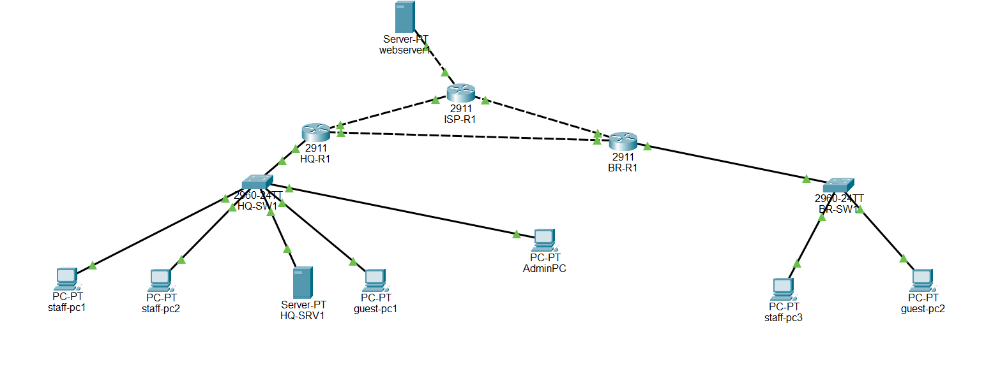

# Secure Multi-Site Clinic Network

A two-site small-business network designed, secured, and tested in Cisco
Packet Tracer. The scenario
is a fictional clinic group, "Northgate Family Clinics", with a headquarters
and a branch. The goal is a documented, reusable network blueprint that a
small multi-location business could adopt.

> **Scope:** this is a simulated lab, not a production deployment. It has not
> been tested on physical equipment. Passwords and keys in the configs are
> lab-only and have been redacted.

## The problem

Small clinics often run a flat, undocumented network where staff devices,
patient systems, and guest Wi-Fi share one segment. A single compromised
device can reach everything, and nobody has a map when something fails. This
project designs a segmented, secured, and documented alternative, and tests
it against written requirements.

## What's built

| Area | Implementation |
|------|----------------|
| Segmentation | VLANs for Staff, Servers, Guest, and Management with a VLSM IP plan |
| Routing | Router-on-a-stick inter-VLAN routing; OSPF between sites; NAT to a simulated ISP |
| Services | DHCP at each site |
| Access control | Guest-isolation ACL (internet only) and a management-network ACL |
| Device security | SSH-only logins, restricted to the management network; port security; unused ports disabled |
| Resilience | IPsec site-to-site VPN with a floating static route for failover |
| Identity (in progress) | Active Directory, DNS, DHCP, Group Policy, and an onboarding/offboarding runbook in VirtualBox |

## Key design decisions

- **Router-on-a-stick** keeps the hardware list small while still separating four VLANs.
- **Guest ACL is applied inbound** on the guest subinterface so unwanted traffic is dropped as it enters the router, and it permits DHCP first so guests can still get an address.
- **Management ACL is applied outbound** on the management subinterface so one rule controls everything heading to that network.
- **The VPN route is a floating static route (distance 200)**, so OSPF stays the preferred path and the encrypted tunnel only takes over if the private link fails.
- **VPN traffic is exempted from NAT**, otherwise it would not match the encryption rule.

## Verification

Requirements come first (`docs/project-scenario.md`), then a test plan with
expected and actual results for every phase. The Phase 1 gap that let a guest
device reach the internal server was recorded as a known gap and closed with
ACLs in Phase 2.

Faults found during the build are recorded with symptom, diagnosis, cause,
fix, and lesson. Examples: a trunk and cabling mismatch that stopped DHCP, a
switch missing its VLAN configuration, router links connected to the wrong
interfaces, and an ISP interface with no IP address.

## Status

| Phase | Scope | Status |
|-------|-------|--------|
| 0 | Scenario and requirements | Complete |
| 1 | Core network: VLANs, DHCP, OSPF, NAT | Complete |
| 2 | Security: ACLs, SSH, port security, VPN | Complete |
| 3 | Active Directory lab and onboarding runbook | In progress |
| 4 | Break-and-fix exercises, final diagram, write-up | Planned |

## Repository guide

| Folder | Contents |
|--------|----------|
| `docs/` | Scenario and requirements, IP addressing plan |
| `diagrams/` | Topology diagrams |
| `configs/` | Device configurations (secrets redacted) |
| `packet-tracer/` | Packet Tracer lab files |
| `tests/` | Test plan and troubleshooting log |

Suggested reading order: `docs/project-scenario.md`, `docs/ip-plan.md`,
`tests/test-plan.md`, `tests/troubleshooting-log.md`.

## Limitations and next steps

- Simulated in Packet Tracer; behaviour on real hardware may differ.
- The Active Directory lab uses a single domain controller with no redundancy.
- A production design would also need backups, monitoring, patching, and a
  formal review against the client's privacy obligations.

## Tools

Cisco Packet Tracer, Cisco IOS, VirtualBox, Windows Server (evaluation),
PowerShell, Git/GitHub.

## Author

Anurag Jassal, Toronto, ON. [LinkedIn](https://www.linkedin.com/in/anurag-jassal)
